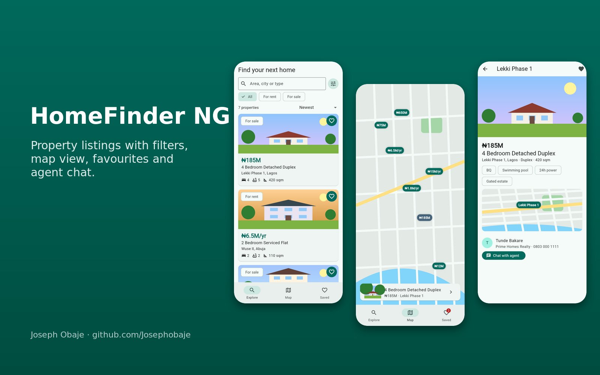
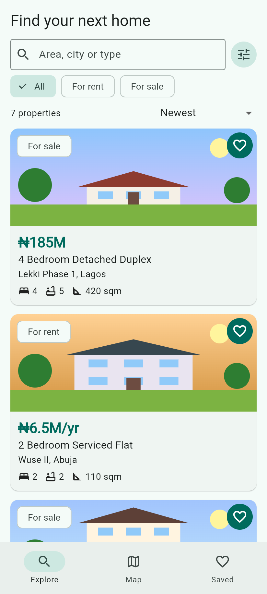
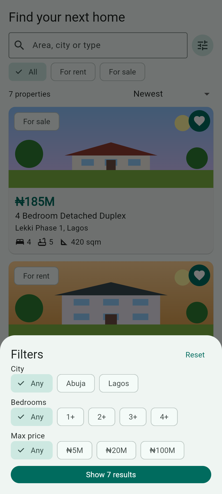
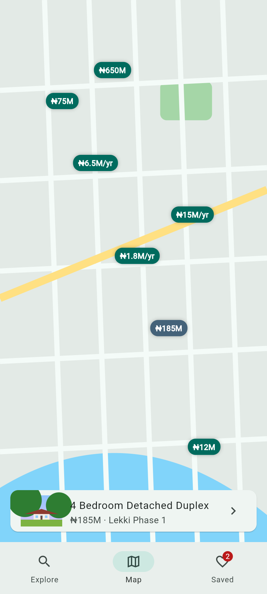
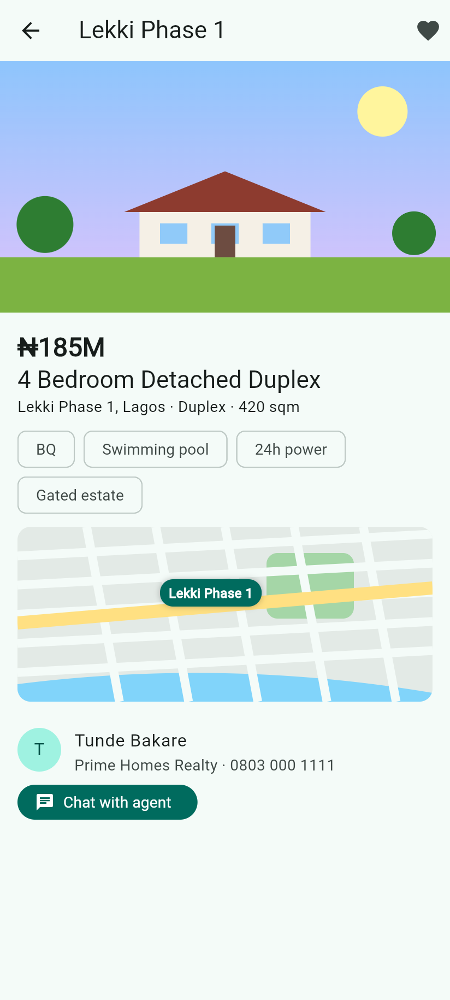
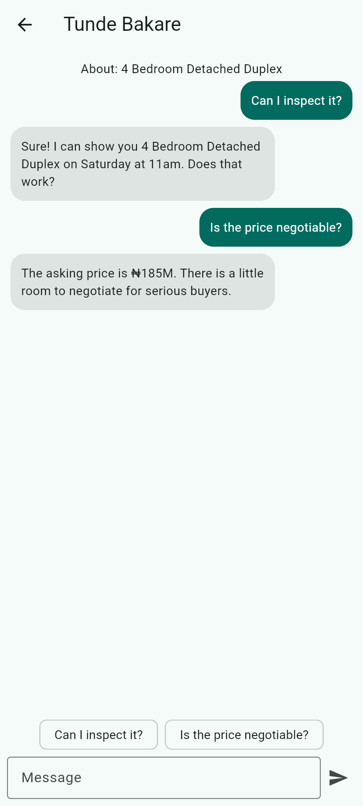
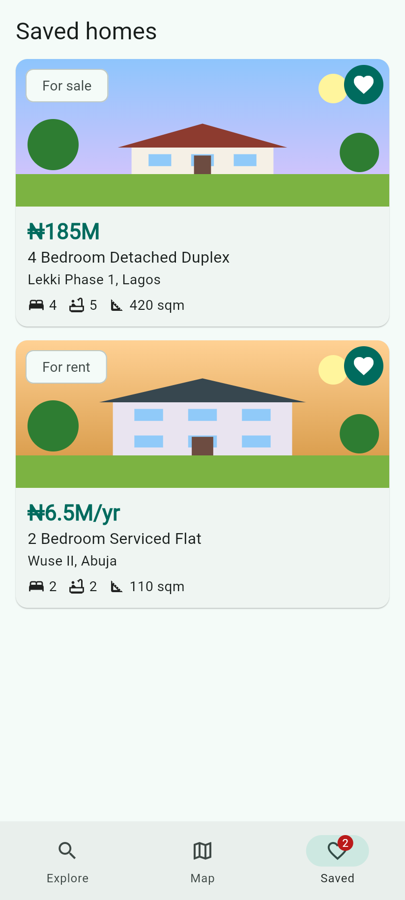

# HomeFinder NG: Flutter Real Estate App


A **property listing app in Flutter** for Lagos and Abuja: browse homes for rent and sale, **search and filter** by city, bedrooms and budget, sort by price, view listings on a **map** (custom-drawn, no API key needed), **save favourites**, and **chat with the agent** about inspections and prices. Property "photos" are **generated illustrations**, so the repo contains no copyrighted images.



| Explore | Filters | Map | Details | Agent chat | Saved |
| --- | --- | --- | --- | --- | --- |
|  |  |  |  |  |  |

## Features

- **Listings**: duplexes, flats, terraces, land; rent shown per year (₦6.5M/yr), sale prices compact (₦185M)
- **Search and filters**: text search, rent/sale chips, city, minimum bedrooms, max price, active-filter badge, reset
- **Sorting**: newest, price low to high, high to low
- **Map view**: price pins on a mock map, tap a pin to preview, tap the preview to open the listing
- **Details**: swipeable gallery, features (BQ, C of O, 24h power), mini map, agent card
- **Agent chat**: quick questions and demo auto-replies (inspection booking, price negotiation)
- **Favourites** with a badge on the Saved tab
- Material 3, light and dark mode

## Tech stack

Flutter 3, Dart 3, provider, CustomPainter, Material 3, flutter_test

## Getting started

```bash
git clone https://github.com/Josephobaje/flutter-real-estate-app.git
cd flutter-real-estate-app
flutter pub get
flutter run
flutter test     # 8 tests
```

## Going live

Load listings from an API (Laravel, Node or Firebase), swap `PropertyArt` for `Image.network` with real photos, replace `MockMap` with `flutter_map` (OpenStreetMap, no key) or `google_maps_flutter`, and back agent chat with Firebase or WebSockets.

## Project structure

```text
lib/
  main.dart   # explore, filters, map, saved, details, agent chat
  data.dart   # Listing, Filters, EstateStore, ₦ formatter, demo data
  art.dart    # generated property illustrations + mock map
test/         # unit + widget tests
```

## Author

**Joseph Obaje**, Full Stack Developer (PHP, Python, Flutter) and Cybersecurity Specialist

- GitHub: [@Josephobaje](https://github.com/Josephobaje)
- LinkedIn: [joseph-obaje](https://www.linkedin.com/in/joseph-obaje)
- Email: [josephobaje264@gmail.com](mailto:josephobaje264@gmail.com)

## License

Released under the [MIT License](LICENSE). © 2026 Joseph Obaje
